# OpenPLC Ladder Exercises (IEC 61131-3)

Five industrial control exercises in Ladder Diagram (LD), built and tested in the
**OpenPLC Editor simulator**. They go from basic latching logic to a conveyor with
timers, a batch counter and interlocks.

All programs run in a single cyclic task (`task0`, **20 ms** scan). No physical PLC
was used.

| # | Exercise | What it solves | Key elements |
|---|---|---|---|
| 1 | [Start/Stop with Set/Reset](#1-startstop-with-setreset--ej1-arranqueparo) | Motor start/stop with latched coils | `S`/`R` coils, rung order |
| 2 | [Start/Stop with seal-in](#2-startstop-with-seal-in--ej2-seal-in) | Same function with a self-holding contact | Seal-in contact, rising edge |
| 3 | [Two-hand control](#3-two-hand-control--ej3-bimanual) | Press only runs if both buttons are pressed within 0.5 s | `TON`, lockout, re-arm |
| 4 | [Traffic-light sequencer](#4-traffic-light-sequencer--ej4-semaforo) | Two-way intersection, 6-step cycle | Chained `TON`, step bits |
| 5 | [Conveyor with batch counter](#5-conveyor-with-batch-counter--ej5-banda) | Start-up warning, part counting, fan run-on | `TON`, `TOF`, `CTU`, `R_TRIG`, interlocks |

## How to open

1. Install the [OpenPLC Editor](https://autonomylogic.com/).
2. *File → Open* and select one exercise folder (for example `Ej5-Banda/`).
3. Build for **OpenPLC Simulator** and start the debugger to force inputs.

Folder and variable names are in Spanish; each section below lists the I/O in English.

---

## 1. Start/Stop with Set/Reset — `Ej1-ArranqueParo`

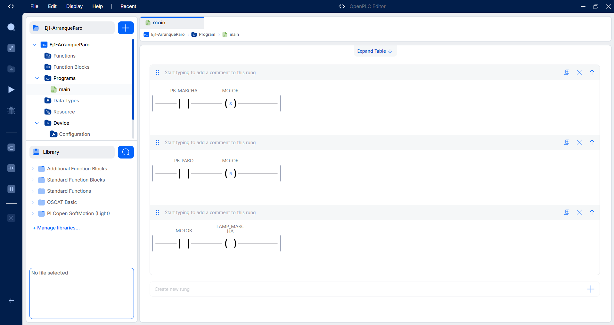

| Variable | Type | Meaning |
|---|---|---|
| `PB_MARCHA` | Input | Start push button |
| `PB_PARO` | Input | Stop push button |
| `MOTOR` | Output | Motor contactor |
| `LAMP_MARCHA` | Output | "Running" lamp |

- Start sets `MOTOR`; stop resets it.
- The reset rung comes after the set rung, so **stop has priority** if both
  buttons are pressed in the same scan.

## 2. Start/Stop with seal-in — `Ej2-Seal-In`

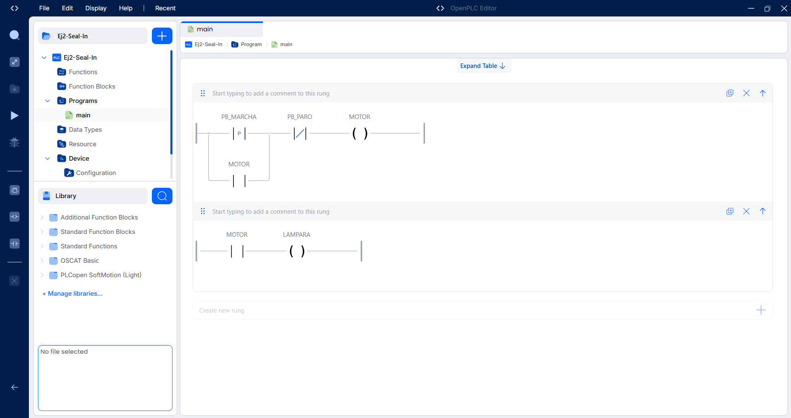

| Variable | Type | Meaning |
|---|---|---|
| `PB_MARCHA` | Input | Start push button |
| `PB_PARO` | Input | Stop push button |
| `MOTOR` | Output | Motor contactor |
| `LAMPARA` | Output | "Running" lamp |

- Classic seal-in: `(rising edge of START OR MOTOR) AND NOT STOP → MOTOR`.
- The rising edge means holding START down does not restart the motor after a stop.

## 3. Two-hand control — `Ej3-Bimanual`

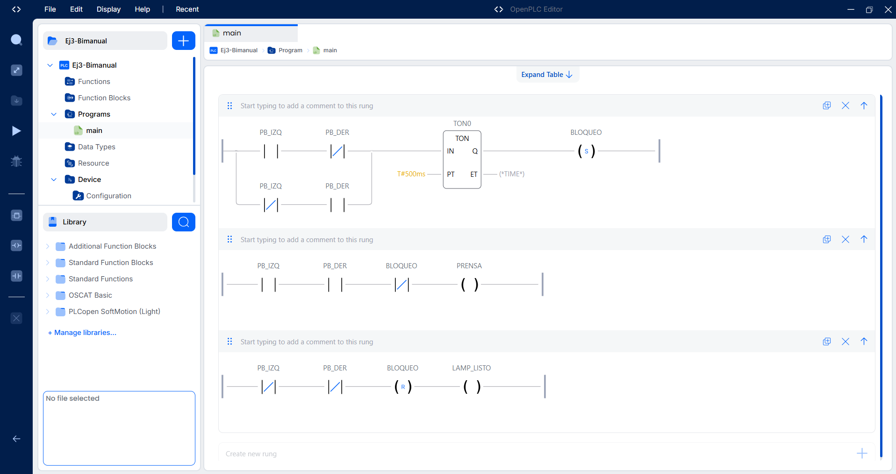

| Variable | Type | Meaning |
|---|---|---|
| `PB_IZQ` / `PB_DER` | Input | Left / right push buttons |
| `PRENSA` | Output | Press actuator |
| `LAMP_LISTO` | Output | "Ready" lamp (both hands released) |
| `BLOQUEO` | Internal | Lockout flag |

- The press runs only while **both** buttons are held and there is no lockout.
- If only one button is held longer than the **0.5 s** synchronization window (`TON0`),
  `BLOQUEO` is set and the press stays blocked.
- The lockout clears only when **both** buttons are released, so the operator
  must re-arm before each cycle.

## 4. Traffic-light sequencer — `Ej4-Semaforo`

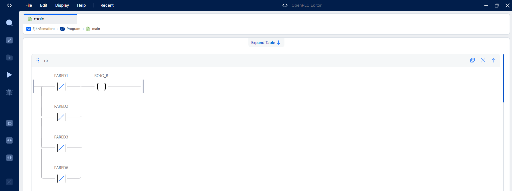
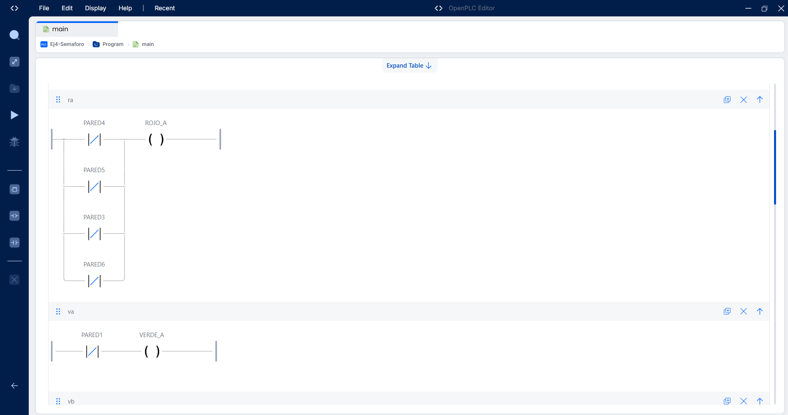
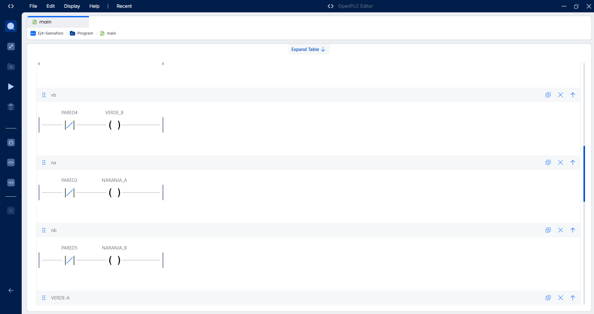
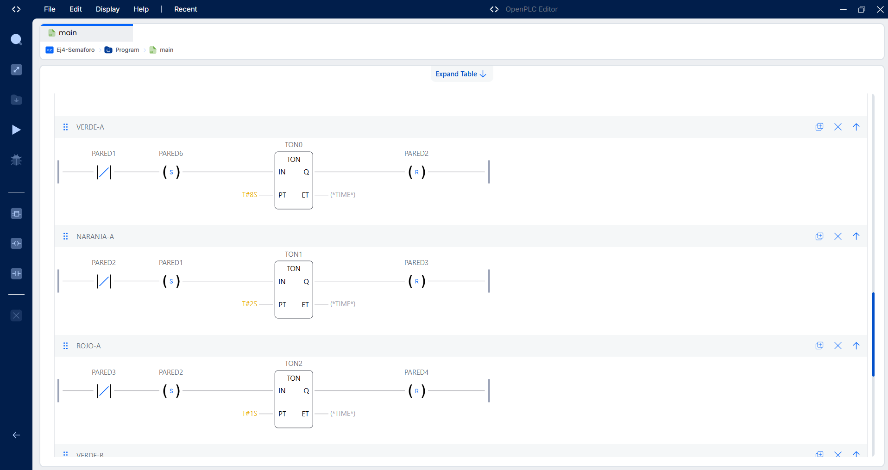
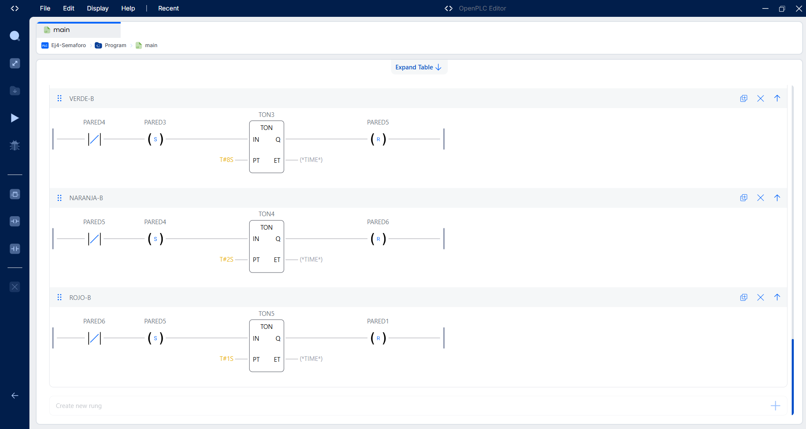

| Variable | Type | Meaning |
|---|---|---|
| `VERDE_A`, `NARANJA_A`, `ROJO_A` | Output | Lights, street A |
| `VERDE_B`, `NARANJA_B`, `ROJO_B` | Output | Lights, street B |
| `PARED1`…`PARED6` | Internal | Step bits of the 6-step cycle |

Cycle: green A **8 s** → amber A **2 s** → all-red **1 s** → green B **8 s** →
amber B **2 s** → all-red **1 s** → repeat.

- Each step is one bit; its `TON` sets the next step and resets the previous one.
- Light rungs are separated from sequence rungs, so outputs depend only on the
  active step.

## 5. Conveyor with batch counter — `Ej5-Banda`

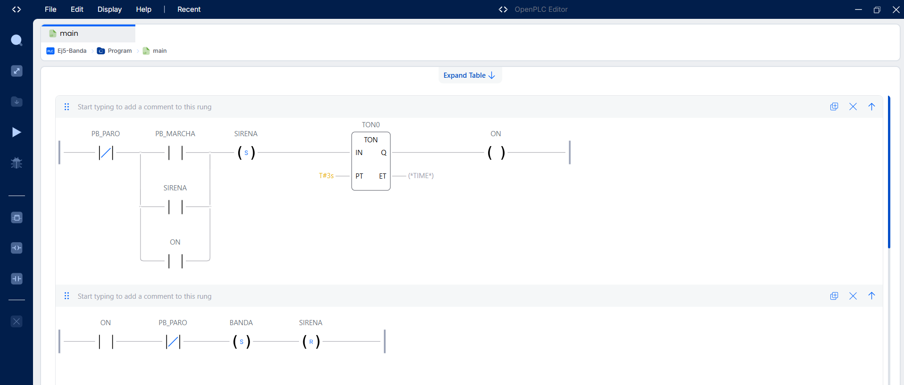
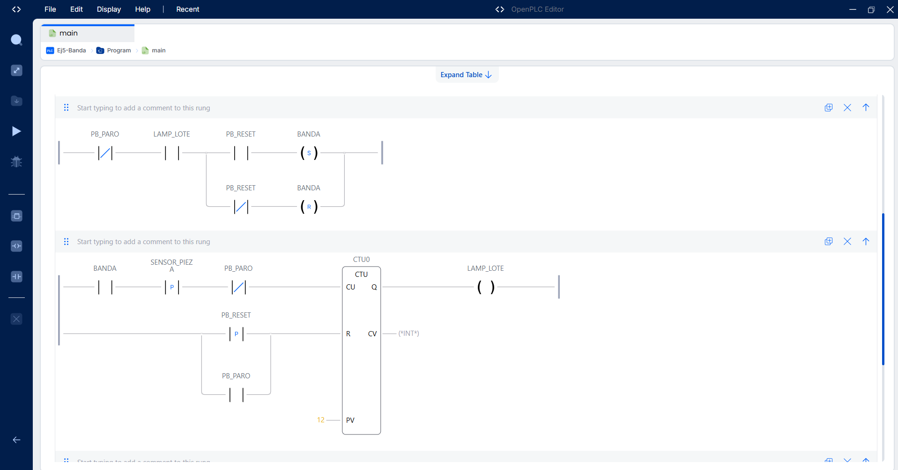
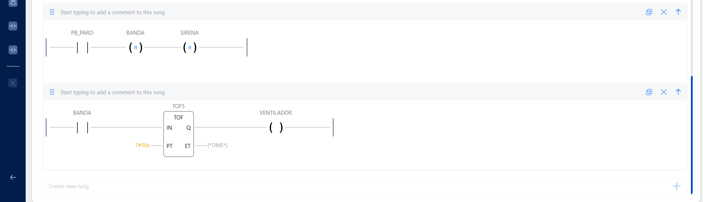

| Variable | Type | Meaning |
|---|---|---|
| `PB_MARCHA` / `PB_PARO` / `PB_RESET` | Input | Start / stop / batch reset |
| `SENSOR_PIEZA` | Input | Part sensor on the belt |
| `BANDA` | Output | Belt motor |
| `SIRENA` | Output | Start-up warning siren |
| `LAMP_LOTE` | Output | "Batch complete" lamp |
| `VENTILADOR` | Output | Motor cooling fan |

- **Start-up warning:** START sounds the siren for **3 s** (`TON0`) before the belt moves.
- **Batch counter:** `CTU0` counts rising edges of the part sensor while the belt
  runs; after **12 parts** it lights `LAMP_LOTE`. Rising edge of RESET (or STOP)
  clears the count.
- **Batch stop:** when the batch completes, the belt stops until RESET is pressed.
- **Fan run-on:** the fan stays on **10 s** after the belt stops (`TOF5`).
- **Stop has priority:** STOP resets belt and siren regardless of other rungs.

---

## Notes

- Simulation only; inputs were forced from the OpenPLC debugger.
